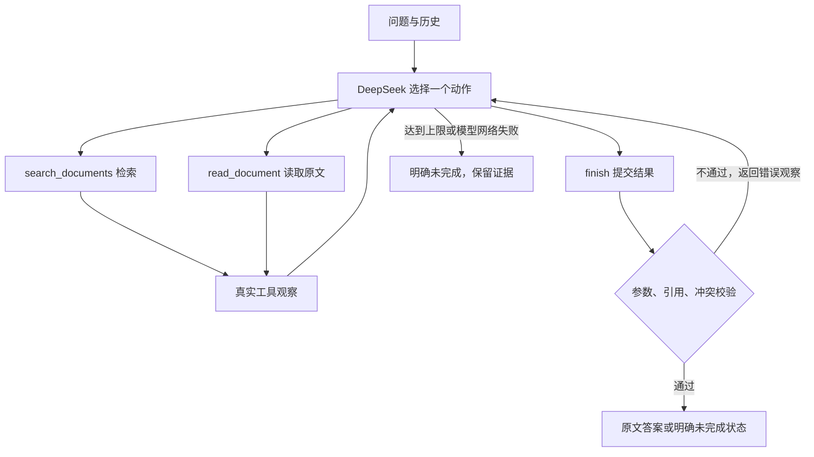

# 02 · 方案、动态决策与取舍

## 调用流程

`agent.py` 是执行骨架：每轮调用 `model.choose(messages, tools)`，解析一次动作，执行允许的工具，把实际结果作为 `role=tool` 消息交回模型。骨架没有按题目、风险或错误码规定下一项业务工具；真实提供方自行选动作、参数和结束状态。无效响应可以在后续模型轮次修正，所有尝试消耗上限；网络错误直接明确停止，避免隐藏重试或假装切换到离线结果。

`finish` 也是模型选择的函数调用，用于结构化提交状态和证据。`tool_choice=required` 约束的是协议，三个动作中没有一个被强制指定。运行时校验失败会形成新的观察，模型可以读取遗漏文档或修正引用。

## 工具、状态与记录

| 工具 | 参数（另含一句公开 `reason`） | 返回 | 副作用 |
|---|---|---|---|
| `search_documents` | `query`、`limit=1..10` | 匹配分、ID、版本、范围、相关文档 ID、是否截断；不含可直接引用的原文 | 无 |
| `read_document` | `document_id` | 元数据及带 ID、`policy_key` 的完整短原文片段 | 无 |
| `finish` | 状态、引用、缺口、追问 | 校验通过的结果，或可供修正的错误观察 | 无；CLI 在结束后保存记录 |

每次运行保留成功检索、成功读取的原文，以及实际失败的调用。已成功读取的结果不会因后续失败而清空。默认最多 **14 次模型决策、12 次动作调用尝试**，`finish`、未知工具和无效参数尝试均占动作预算。达到任一上限返回 `limit_reached`；被上限挡住的下一动作标注 `executed=false`。上限只限制调用数，不代表整个进程的严格墙钟时限；单次模型请求配置超时 30 秒、最多 60 秒。

业务状态：`answered`、`needs_clarification`、`not_found`、`tool_error`；运行时还可返回 `model_error`、`limit_reached`。输入/配置不合法在运行前返回 `invalid_input`。CLI 为业务未完成状态返回非零退出码。

Trace 写入每轮公开动作、参数、实际观察、返回摘要、下一动作，以及可得的 API response ID、模型名、token 用量。不会存储 API 密钥、HTTP 请求头、模型内部推理文本。完整观察保存于 JSON，人可阅读的摘要由这些实际事件渲染。

## 根据观察改变动作

下表是**实际离线替身**的运行路径，真实模型结果尚待验证。

| 工具观察 | 后续动作 | 实际记录 |
|---|---|---|
| 命中年假资料、原文没有同范围差异 | 读取 D03 后引用 C01 结束 | [正常](../examples/mock/01-clear/trace.md) |
| 读到 D01=30 天、D02=15 天 | 补查适用范围/优先级，仍无依据则引用双方并追问 | [冲突](../examples/mock/02-conflict/trace.md) |
| 首次检索无命中 | 改写查询后再检索；仍无结果则说明缺口 | [资料外](../examples/mock/03-out-of-domain/trace.md) |
| 第一次检索报错 | 下一轮替身选择再试一次 | [暂时失败](../examples/mock/06-transient-tool-failure/trace.md) |
| D01 读取成功，D02 连续失败 | 保留 D01，停止并返回 tool_error | [持续失败](../examples/mock/07-persistent-tool-failure/trace.md) |
| 将 D02 原文改成与 D01 相同 | 不再补查冲突或追问，直接引用原文 | [消除差异](../examples/mock/11-conflict-removed/trace.md) |

`mock_model.py` 是可观察结果驱动的确定性测试替身。它只能读取问题、历史和工具观察，不能访问知识库文件、用例 ID、预期答案或预录 Trace；但它仍是人工规则，不是 LLM，因此其动态路径不能作为真实模型 ReAct 效果证据。

## 引用与冲突边界

1. 只接受本次成功 `read_document` 的短片段，`quote` 必须逐字等于该片段完整 `text`。版本日期从读取结果补入，不由模型编写。
2. 事实答案从模型选择的原文引用渲染，不接受自由填写的事实答案字段，避免“引用 10 天却回答 100 天”。模型仍负责证据相关性、选择哪个片段、何时继续搜索及何时结束。
3. 维护者为片段标注 `policy_key` 和范围 `scope`。同键、同范围的候选文档会互相链接，避免只看 top-1 隐藏 D02。引用前要求读取关联文档。
4. 同键同范围但原文不同，保守地标记待核实差异。当前资料没有优先级或废止证明，模型不能用日期自动消解。冲突澄清结果必须引用双方。

这一实现牺牲了自由摘要的流畅度，换取精确可检查的事实来源。它不能保证语义相关性和检索召回率，也无法自动识别不同 `policy_key` 或不同文字范围下的所有真实冲突；措辞等价也可能被保守拦截。生产环境需要资料治理、语义检索、范围判定及人工反馈。

## 技术取舍与接口来源

- Python 标准库：无需框架依赖，评审能直接追踪模型、工具、观察与边界。没有需要声明版本和职责的 Agent 框架；本机 Python 版本记录在测试摘要中。
- 本地双字匹配与同义词扩展：五份资料足够演示。标题/关键词权重 3，正文权重 1，最低分 3，降低“公司”等泛词单次命中的影响。大量文档时应换为带召回评测的检索方案。
- DeepSeek Chat Completions：显式关闭思考模式，使用标准端点、`max_tokens` 和函数工具调用，避开 Beta strict 依赖，本地负责校验。若响应含多个工具调用，将整体拒绝并要求重新选择一个动作，不会悄悄只执行其中一项。

接口说明核对日期 2026-10-28：[DeepSeek 工具调用](https://api-docs.deepseek.com/guides/tool_calls/)、[DeepSeek 请求参数](https://api-docs.deepseek.com/api/create-chat-completion/)。可选 OpenAI 入口参考 [官方 Function Calling](https://developers.openai.com/api/docs/guides/function-calling)；它不是本次主验收提供方。
